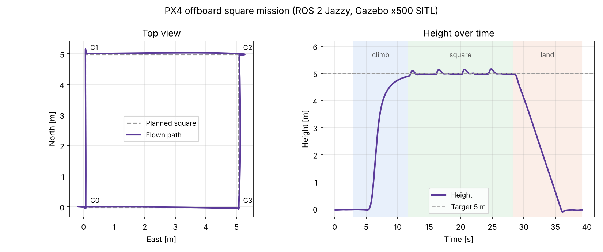

# PX4 + ROS 2 Offboard Control

ROS 2 (Jazzy) nodes that control a PX4 quadrotor in **offboard mode**, tested in
software-in-the-loop (SITL) simulation with Gazebo Harmonic and the x500 model.

This is the first part of a project that compares the PX4 default controller,
a custom **MPC** controller and a learned **RL** controller on the same
trajectory-tracking tasks.



## Results so far

| Controller | Task | Path error (RMS) | Max path error | Height along square |
|---|---|---|---|---|
| PX4 position control (baseline) | 5 x 5 m square at 5 m | 0.08 m | 0.25 m | 4.90 to 5.16 m |

The small height dips at each corner happen when the drone brakes and turns.
Reducing them is the target for the custom controllers.

## How it works

```
 Gazebo (physics)  <->  PX4 autopilot  <->  Micro XRCE-DDS Agent  <->  ROS 2 node
                         (SITL)              (UDP 8888)                (square_mission.py)
```

`square_mission.py` runs at 10 Hz and:

1. streams an `OffboardControlMode` heartbeat (PX4 leaves offboard mode if it stops),
2. publishes a `TrajectorySetpoint` (target position in NED: x north, y east, z down),
3. switches PX4 to offboard mode and arms through `VehicleCommand`,
4. reads `VehicleLocalPosition` and `VehicleStatus` to move from corner to corner,
5. lands at the end and logs the flight to `~/square_log.csv`.

## Setup

Tested on Ubuntu 24.04 (WSL2), ROS 2 Jazzy, PX4-Autopilot (main), Gazebo Harmonic.

```bash
# workspace with px4_msgs built from your own PX4 version
mkdir -p ~/ws_px4/src && cd ~/ws_px4/src
git clone https://github.com/PX4/px4_msgs.git
cd px4_msgs && rm -f msg/*.msg srv/*.srv
cp ~/PX4-Autopilot/msg/*.msg msg/ && cp ~/PX4-Autopilot/msg/versioned/*.msg msg/
cp ~/PX4-Autopilot/srv/*.srv srv/
cd ~/ws_px4/src && git clone https://github.com/srachit29/px4-ros2-offboard.git
cd ~/ws_px4 && colcon build && source install/setup.bash
```

PX4 topic names carry version suffixes (`vehicle_status_v5`, `vehicle_command_v1`, ...).
If your PX4 version differs, check `ros2 topic list | grep fmu` and adjust the
topic names at the top of `square_mission.py`.

## Running

```bash
# terminal 1
MicroXRCEAgent udp4 -p 8888
# terminal 2
cd ~/PX4-Autopilot && make px4_sitl gz_x500
# terminal 3
ros2 run px4_offboard square_mission
# plot the flight
python3 tools/plot_square.py ~/square_log.csv square_plot.png
```

### Simulation-only PX4 parameters

Without an RC transmitter or ground station, PX4 triggers return-to-home a few
seconds into the flight. For SITL only, set in the `pxh>` console:

```
param set NAV_DLL_ACT 0       # no action on ground-station loss
param set NAV_RCL_ACT 0       # no action on RC loss
param set COM_RCL_EXCEPT 4    # ignore RC loss in offboard mode
param set COM_OF_LOSS_T 3     # offboard signal timeout 3 s
```

Never use these settings on a real vehicle.

## Roadmap

- [x] PX4 SITL + ROS 2 bridge, offboard square mission, logging and plots
- [ ] Custom position controller (PD, then LQR) sending acceleration setpoints
- [ ] Model Predictive Control (MPC)
- [ ] Reinforcement learning controller
- [ ] Comparison on square, figure-eight and wind-disturbance tests

## Related work

- [Geometric/LQR control of a morphing quadrotor in NVIDIA Isaac Sim](https://github.com/srachit29/quadrotor-geometric-lqr-control)

## License

MIT
