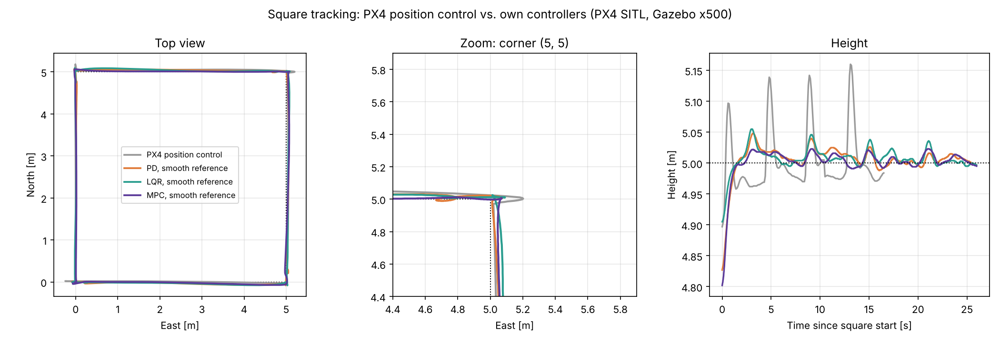
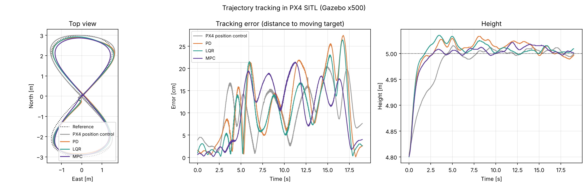
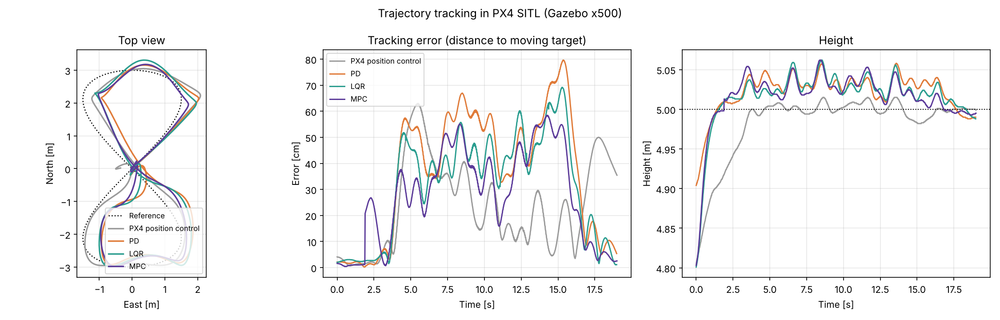
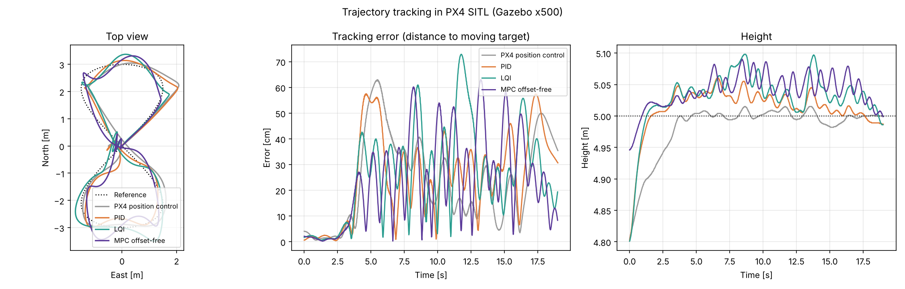

# PX4 + ROS 2 Offboard Control

ROS 2 (Jazzy) nodes that control a PX4 quadrotor in **offboard mode**, tested in
software-in-the-loop (SITL) simulation with Gazebo Harmonic and the x500 model.

This is the first part of a project that compares the PX4 default controller,
a custom **MPC** controller and a learned **RL** controller on the same
trajectory-tracking tasks.



## Results so far

5 x 5 m square at 5 m height, 4 s per side, PX4 SITL with Gazebo x500.
Own controllers send acceleration setpoints; PX4 only handles attitude and motors.

| Controller | Reference | Path error RMS | Path error max | Height error RMS | Height error max |
|---|---|---|---|---|---|
| PX4 position control | corner to corner | 8.4 cm | 24.7 cm | 5.1 cm | 16.0 cm |
| Own PD | constant speed | 19.8 cm* | 83.4 cm* | 3.7 cm | 19.6 cm |
| Own PD | minimum-jerk + feed-forward | 3.8 cm | 9.4 cm | 2.6 cm | 17.3 cm |
| Own LQR (q_p=9, q_v=4, r=1) | minimum-jerk + feed-forward | 3.9 cm | 9.5 cm | **2.0 cm** | **9.5 cm** |
| Own MPC (1.5 s horizon, lag + delay model) | minimum-jerk, full preview | **3.7 cm** | **8.2 cm** | 2.6 cm | 19.8 cm |

\* this run also contains one estimator position jump.

**Findings**

- The biggest improvement comes from the **reference**, not the gains: a minimum-jerk
  trajectory with acceleration feed-forward cut the path error of the same PD controller
  from 20 cm to 4 cm and removed the corner overshoot.
- LQR with too little velocity weight (q_v = 1) overshot corners (7 cm RMS). LQR is only
  optimal for its model, and the point-mass model ignores the drone's response lag.
  Raising q_v to 4 fixed it.
- From the logs, the drone follows acceleration commands with about **0.08 s delay and a
  0.2 s time constant** (`tools/fit_lag.py`). The MPC (`mpc.py`) uses this model, predicts
  1.5 s ahead and sees each corner coming. It gave the smallest path error and held the
  corners best (9 cm RMS error while hovering at corners, vs. 15 cm for LQR and 17 cm for PD).
  It solves in about 1 ms per step (projected-gradient QP, numpy only).
- While moving, MPC trails the target by about 7 cm on average (LQR: 2.5 cm). Telling the
  MPC the drone is slower (tau 0.3 s instead of 0.2 s) did not reduce this (7.4 cm), so the
  cause is not the lag model; it is still open.
- The PX4 baseline flew a different (corner-to-corner) pattern, so it is a reference
  point rather than a strict comparison.

**Data quality:** in WSL2 SITL, PX4's position estimate sometimes jumps (up to 11 m in one
20 ms step). `tracking_square.py` checks that position matches velocity x time and marks
such runs as not valid. Apart from the marked PD run (kept to show the overshoot), only valid runs are in the table.


### Figure-eight (6 x 3 m, up to 2.2 m/s, one lap)

All four controllers follow the same minimum-jerk figure-eight with feed-forward; the PX4
baseline (`controller:=px4`) receives position, velocity and acceleration setpoints of the
same reference. Repeated valid runs agreed within about 1 cm.



| Controller | Tracking error RMS | Tracking error max | Path error RMS | Height error RMS |
|---|---|---|---|---|
| PX4 position control | **11.6 cm** | **20.5 cm** | **7.2 cm** | 4.5 cm |
| Own PD | 13.7 cm | 27.4 cm | 10.5 cm | 3.2 cm |
| Own LQR | 12.0 cm | 26.4 cm | 8.6 cm | 3.1 cm |
| Own MPC (delay 0) | 12.5 cm | 21.4 cm | 10.2 cm | 3.1 cm |

- On continuous curves, PX4's tuned cascaded controller tracks best in the horizontal plane;
  the own controllers hold height better (3 cm vs. 4.5 cm).
- MPC is sensitive to its model: with the 0.08 s input delay identified on the square, it
  reached 15.4 cm; the figure-eight logs show a shorter delay (0-0.04 s), and with delay 0 it
  improved to 12.5 cm with the smallest maximum error of the own controllers. Offline, with an
  exact model, the same MPC reaches 2-4 cm, so model mismatch (tilt dynamics, drag) is the
  remaining limit.

### Wind disturbance (figure-eight, one lap)

Wind is modelled as an acceleration disturbance added to every controller's command (also to
PX4's acceleration feed-forward): a steady 1 m/s^2 push to the east (about 1.5 N on the
1.5 kg vehicle) plus a 1 m/s^2 north-south gust at 0.5 Hz, active from 3 s until 3 s before the end.



| Controller | Tracking error RMS (wind active) | Max error | East offset at end of wind |
|---|---|---|---|
| PX4 position control | **30.6 cm** | 63.0 cm | **8 cm** (shrinking) |
| Own PD | 52.2 cm | 79.6 cm | 55 cm |
| Own LQR | 44.8 cm | 69.2 cm | 48 cm |
| Own MPC | 39.7 cm | **58.4 cm** | 43 cm |

- PX4's cascaded controller has integral action and slowly removes the steady offset. The own
  PD, LQR and MPC have none, so the steady wind pushes them off by 43-55 cm for as long as it blows.
- Among the own controllers, MPC handles the gusts best (smallest maximum error of all).
- The MPC run contains one small (0.2 m) estimator jump at 1.9 s, before the wind starts;
  the wind-window metrics are not affected.

#### With integral action / offset-free MPC (`-p integral:=true`)

- PD becomes PID (integral of the position error, anti-windup).
- LQR becomes LQI: LQR on [integral of error, error, error rate].
- MPC becomes offset-free: a disturbance observer compares the measured velocity change with
  the acceleration the model expected, low-pass filters the difference (0.5 s) and the MPC
  compensates it.



| Controller | Tracking error RMS (wind active) | Max error | East offset at end of wind | Valid runs |
|---|---|---|---|---|
| PX4 position control | 30.6 cm | 63 cm | 8 cm | 2 |
| Own MPC, offset-free | 30.5 cm (25-33) | 58 cm (47-65) | 5-9 cm | 3 |
| Own PID | 31.5 cm | **57.5 cm** | 9 cm | 1 |
| Own LQI | 34.3 cm (33-35) | 71-73 cm | 4-5 cm | 3 |

- Integral action removes the steady offset (43-55 cm -> 4-9 cm) and brings the own
  controllers level with PX4 in wind (30-34 cm vs. 30.6 cm), from 30-70 % worse before.
- Run-to-run spread is larger in wind (MPC 25-33 cm), so the remaining differences between
  PX4, offset-free MPC and PID are within that spread.

### Simulator timing issue

On this setup (WSL2, Gazebo Harmonic), the simulation occasionally advances about 2.5 s
while the ROS 2 node advances only 20 ms, so the vehicle flies on its last command. The node
logs PX4's simulation time next to its own clock and marks such runs as not valid; disabling
PX4's time sync (`UXRCE_DDS_SYNCT 0`) did not remove it. Each controller was therefore flown
several times and only valid runs are reported.

## How it works

```
 Gazebo (physics)  <->  PX4 autopilot  <->  Micro XRCE-DDS Agent  <->  ROS 2 node
                         (SITL)              (UDP 8888)                (square_mission.py)
```

`square_mission.py` runs at 10 Hz and:

1. streams an `OffboardControlMode` heartbeat (PX4 leaves offboard mode if it stops),
2. publishes a `TrajectorySetpoint` (target position in NED: x north, y east, z down),
3. switches PX4 to offboard mode and arms through `VehicleCommand`,
4. reads `VehicleLocalPosition` and `VehicleStatus` to move from corner to corner,
5. lands at the end and logs the flight to `~/square_log.csv`.

## Setup

Tested on Ubuntu 24.04 (WSL2), ROS 2 Jazzy, PX4-Autopilot (main), Gazebo Harmonic.

```bash
# workspace with px4_msgs built from your own PX4 version
mkdir -p ~/ws_px4/src && cd ~/ws_px4/src
git clone https://github.com/PX4/px4_msgs.git
cd px4_msgs && rm -f msg/*.msg srv/*.srv
cp ~/PX4-Autopilot/msg/*.msg msg/ && cp ~/PX4-Autopilot/msg/versioned/*.msg msg/
cp ~/PX4-Autopilot/srv/*.srv srv/
cd ~/ws_px4/src && git clone https://github.com/srachit29/px4-ros2-offboard.git
cd ~/ws_px4 && colcon build && source install/setup.bash
```

PX4 topic names carry version suffixes (`vehicle_status_v5`, `vehicle_command_v1`, ...).
If your PX4 version differs, check `ros2 topic list | grep fmu` and adjust the
topic names at the top of `square_mission.py`.

## Running

```bash
# terminal 1
MicroXRCEAgent udp4 -p 8888
# terminal 2
cd ~/PX4-Autopilot && make px4_sitl gz_x500
# terminal 3
ros2 run px4_offboard square_mission
# own controllers (pd | lqr | lqr_lag, reference linear | smooth)
ros2 run px4_offboard tracking_square --ros-args -p controller:=lqr -p q_v:=4.0
# compare flights
python3 tools/compare_all.py out.png "PD=~/square_pd_smooth.csv" "LQR=~/square_lqr_smooth.csv"
python3 tools/fit_lag.py ~/square_lqr_smooth.csv
```

### Simulation-only PX4 parameters

Without an RC transmitter or ground station, PX4 triggers return-to-home a few
seconds into the flight. For SITL only, set in the `pxh>` console:

```
param set NAV_DLL_ACT 0       # no action on ground-station loss
param set NAV_RCL_ACT 0       # no action on RC loss
param set COM_RCL_EXCEPT 4    # ignore RC loss in offboard mode
param set COM_OF_LOSS_T 3     # offboard signal timeout 3 s
```

Never use these settings on a real vehicle.

## Roadmap

- [x] PX4 SITL + ROS 2 bridge, offboard square mission, logging and plots
- [x] Custom position controller (PD, then LQR) sending acceleration setpoints
- [x] Minimum-jerk reference with feed-forward, lag identification from flight logs
- [x] Model Predictive Control (MPC)
- [ ] Reinforcement learning controller
- [x] Figure-eight comparison (incl. fair PX4 baseline on the same reference)
- [x] Wind-disturbance test
- [x] Integral action / offset-free MPC

## Related work

- [Geometric/LQR control of a morphing quadrotor in NVIDIA Isaac Sim](https://github.com/srachit29/quadrotor-geometric-lqr-control)

## License

MIT
